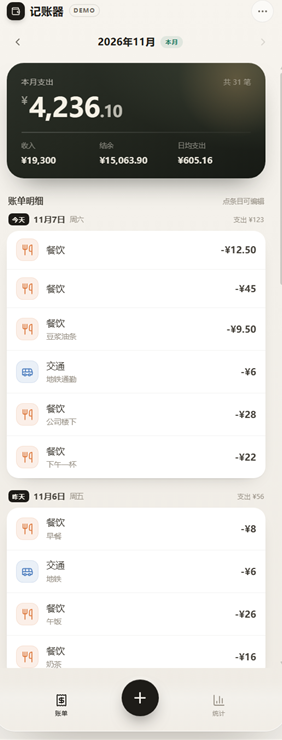
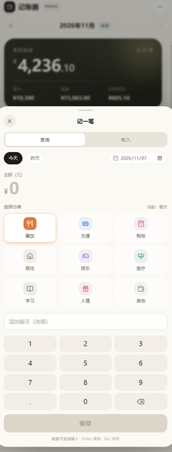
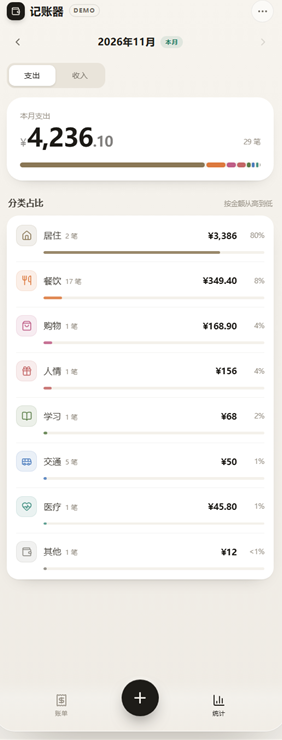
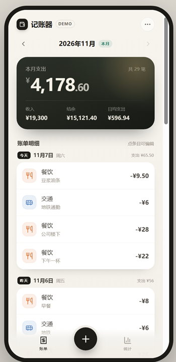

# 记账器

单用户轻量记账的纯前端应用，可以装到手机主屏当 App 用（PWA）。所有数据只保存在浏览器 `localStorage`，不会上传到任何服务器。

## 界面预览

| 账单流 | 记一笔 | 月度统计 |
| --- | --- | --- |
|  |  |  |

手机宽度（390 × 844）下的账单页：



## 本地运行

```bash
npm install
npm run dev      # http://127.0.0.1:5173
```

首次打开会自动写入一份示例账单（含本月和上月记录），方便直接看列表和统计效果。

## 安装到手机主屏

需要一个 HTTPS 地址打开应用（本地 `npm run dev` 不能安装）。

- **iPhone / iPad**：用 Safari 打开，点底部「分享」→「添加到主屏幕」。
- **Android**：用 Chrome 打开，点右上角菜单 →「安装应用」或「添加到主屏幕」。

装好后从主屏图标启动，是全屏无地址栏的独立窗口，图标是墨色底加米白 ¥。

## 离线使用

首次打开、并且页面完整加载过一次之后，页面本身（HTML、JS、CSS、图标、manifest）会被 Service Worker 缓存下来。之后即使断网、开飞行模式，从主屏图标启动仍然可以打开并记账，数据照常存在本机。

- 页面导航走缓存优先：打开时先用本地缓存瞬间出页面，同时在后台把新版本拉回来，所以弱网、断网都不会卡在等网络上。
- 新版本在后台下载完成后，下次冷启动生效；如果发现还是旧界面，把应用从后台彻底划掉再打开一次。
- 开发模式（`npm run dev`）故意不注册 Service Worker，避免旧缓存挡住改动。

## 账本

顶部月份下面是一条账本切换栏：**全部** + 每个账本 + 末尾的 **＋**。

- 选「全部」把各账本的记录合并着看；选某个账本只看它自己的。
- 记账面板顶部的「记到」决定这笔进哪个账本，默认沿用你上次记账用的那个（在「全部」视图下也不会记到「全部」上）。
- 点 **＋** 打开「管理账本」：可以新增（最多 8 个字）、改名、删除。删除账本时，里面的记录会**整批转到**另一个账本，确认框会写明「N 条记录会转到「某某」」，记录不会丢失；只剩一个账本时不允许删。
- 新装应用预置五个账本：现金、微信、支付宝、生活、工作。旧版（只有一份账本）的数据会在首次打开时自动迁移到 v2，记录一条不少，全部归到「现金」。

数据仍然只存在本机 `localStorage`，存储键不变（`jizhangqi.v1`），只是信封里多了 `accounts` 和每笔记录的 `accountId`。

## 备份与恢复

右上角 **···** 菜单里的「导出/导入备份」：

- **导出**：生成 `jizhangqi-backup-20261107-1650.json`（时间戳取本地时间），可以下载成文件，也可以直接复制 JSON 文本。导出内容会显示在面板里，方便确认。
- **导入**：选择备份文件后，面板会提示「有效 N 条 / 跳过 M 条，将替换当前 K 条」，点「确认导入」才会真正替换整个账本，导入后自动跳到当月账单页。
- 旧版（version 1、没有 accounts 字段）的备份也能直接导入，记录会全部落到「现金」。
- 备份文件是纯 JSON，格式为 `{ app, version, exportedAt, accounts, records }`（version 2），记录字段与本地存储一致；损坏的单条记录会被跳过，不会让整份备份失败。

换手机、清理浏览器数据、卸载重装之前，先导出一份备份。导入采用整账本替换，不做按 id 合并。

## 可以体验的流程

- 点底部中央 **+**，用数字键盘输入金额，选分类、日期，保存（默认支出 / 今天）
- 点账单里的任意一条，修改金额、分类、日期、备注，或删除（删除有二次确认）
- 左滑一条记录（或长按它 0.5 秒）会露出红色「删除」，同样需要二次确认；左滑时上下滚动不受影响
- 切到 **统计**，在支出 / 收入之间切换，查看分类占比
- 用月份左右箭头查看上月；当前月不能再往后翻
- 右上角 **···** 只有两项：导出/导入备份、清空所有记录（清空前二次确认），底部显示当前版本号与构建时间（如 v0.1.2 · 11-08 12:34），用来确认手机上跑的是不是最新一次构建

## 质量检查

```bash
npm test         # Vitest + Testing Library，共 128 个用例
npm run build    # tsc 类型检查 + 生产构建（同时生成 sw.js）
```

构建产物在 `dist/`，包含 `index.html`、`assets/`、`manifest.json`、`icons/` 和自动生成的 `sw.js`。`sw.js` 的缓存名带构建时间戳，每次构建都会换名，旧缓存由 `activate` 清理。

## 部署到 GitHub Pages

仓库已带 `.github/workflows/deploy.yml`：推到 `main` 后自动跑测试、构建并发布到 GitHub Pages。

1. 把仓库推到 GitHub（需 public 仓库，Pages 免费版不支持私有仓库）。
2. 仓库 **Settings → Pages → Build and deployment → Source** 选 **GitHub Actions**。
3. 之后每次 push 到 `main`，Actions 会执行 `npm ci → npm test → npm run build`，把 `dist/` 发布到 `https://<用户名>.github.io/<仓库名>/`。

构建用相对路径（`base: './'`），所以子路径部署、自定义域名都能直接用；`dist/` 不需要提交到仓库。

## 说明

- 技术栈：React 19 + Vite + TypeScript，无后端、无第三方 UI 框架，PWA 部分不依赖 `vite-plugin-pwa`
- 金额以“分”为整数存储，避免浮点误差
- 登录、云同步、预算、OCR 等均未实现